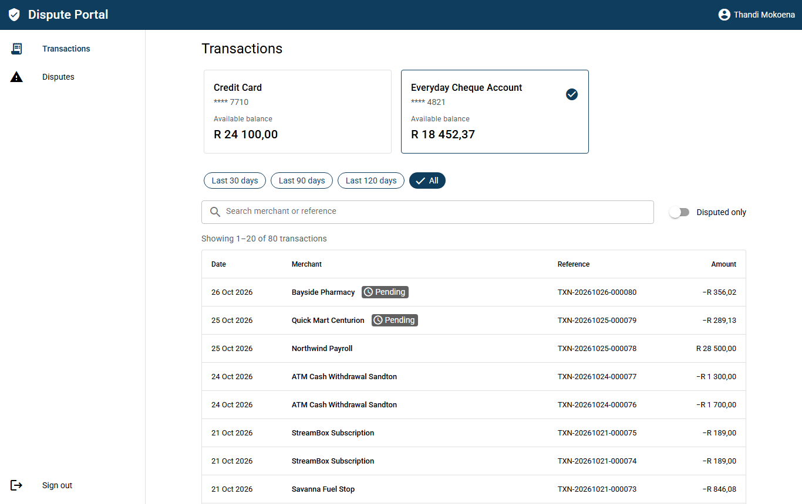
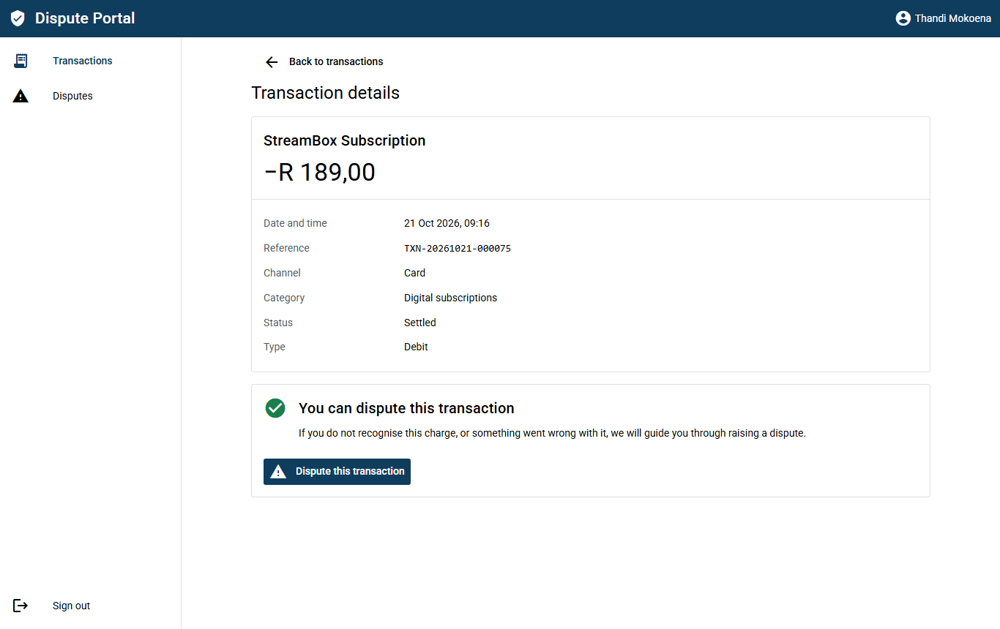
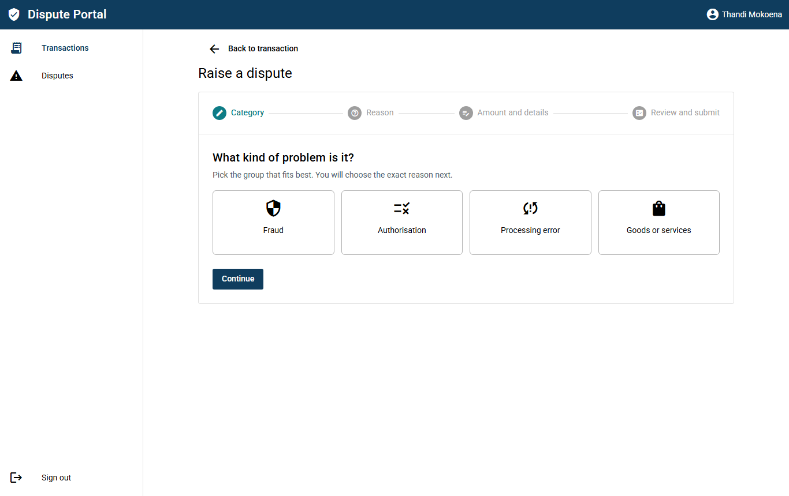
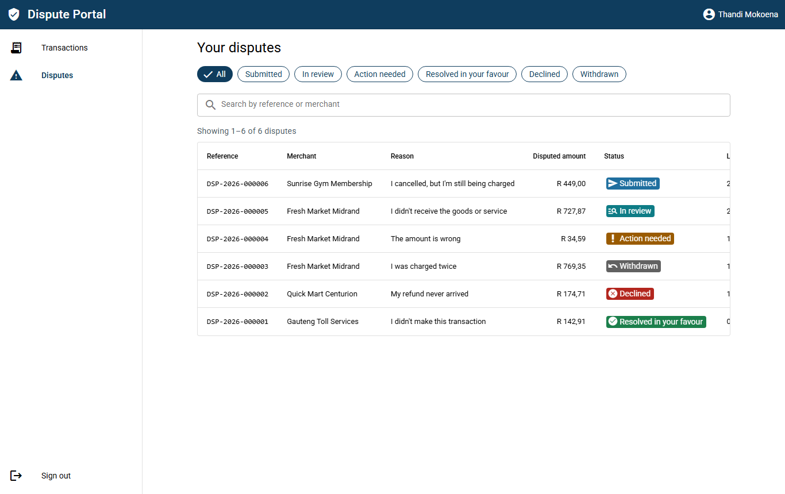
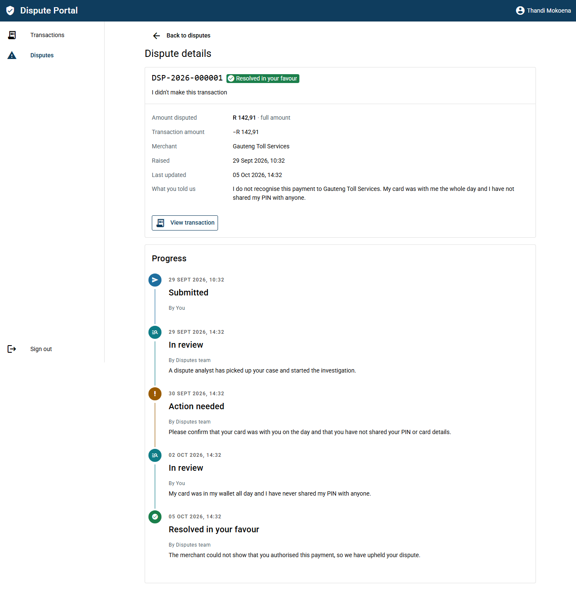
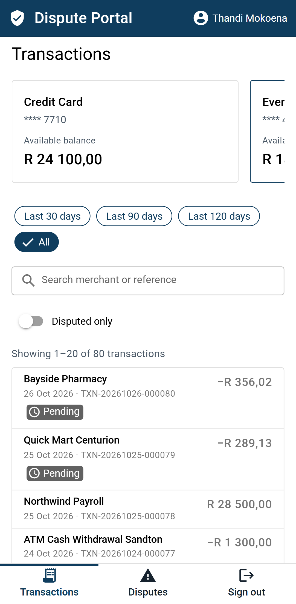
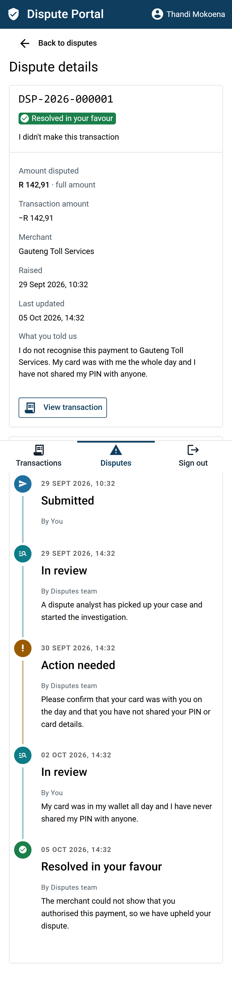
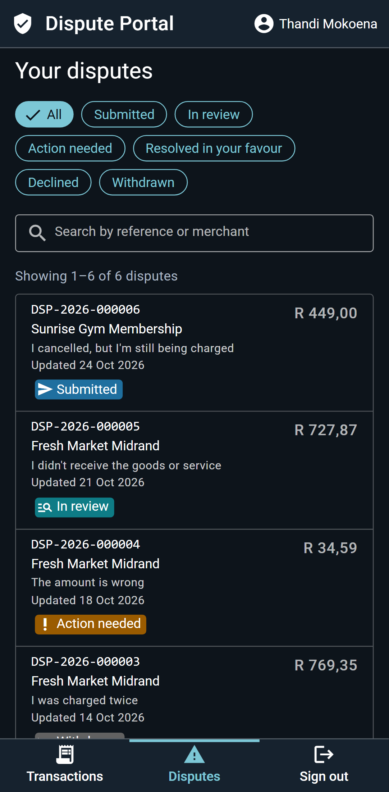
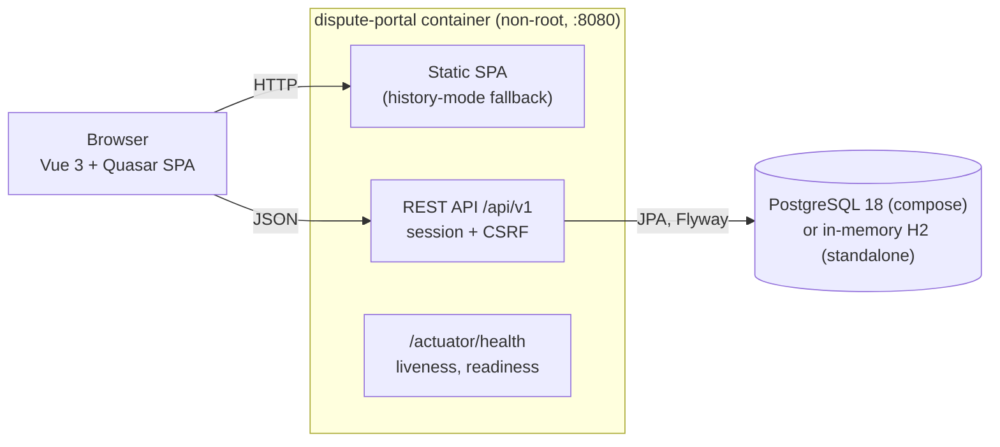
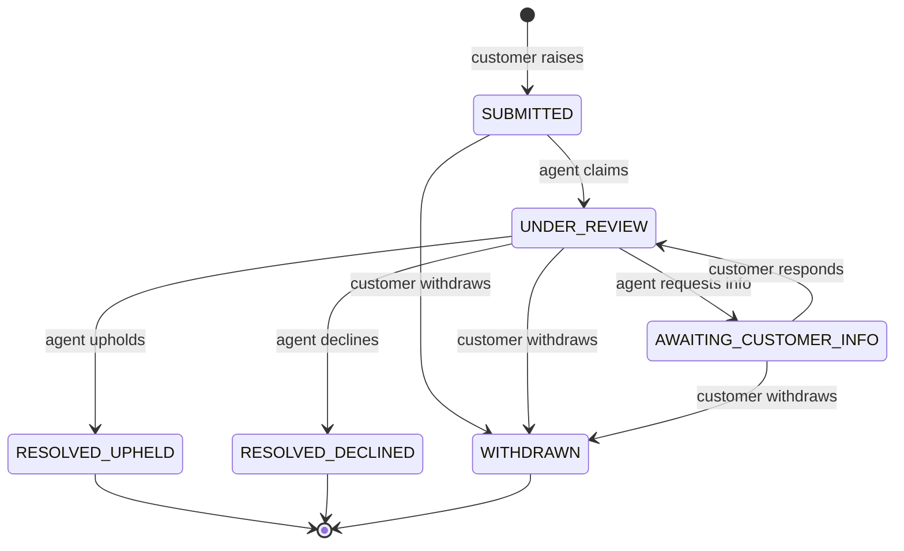

# Transactions Dispute Portal

[](https://github.com/clyde-homu/transactions-dispute-portal/actions/workflows/ci.yml)

Customers view their bank transactions, dispute them and see a history of their disputes, with a status timeline for each one.

## Features

| Brief | What the app does |
| --- | --- |
| View transactions | Sign in, switch between your accounts, and page through transactions filtered by date range, merchant or reference search, and "disputed only". Each transaction's detail page explains whether it can be disputed, and if not, why not (still pending, a credit, older than 120 days, or already disputed). |
| Dispute them | A four-step form: category, specific reason, amount (the full amount or part of it) with a description, then a review with a declaration. On success you get a reference such as `DSP-2026-000123` and an explanation of what happens next. |
| Historic view of disputes | A dispute history filterable by status and searchable by reference or merchant, and a detail page with a timeline of every status change. Open disputes can be withdrawn. |

### Screenshots

| Transactions | Transaction detail and eligibility |
| --- | --- |
|  |  |
| **Raising a dispute** | **Dispute history** |
|  |  |

<p>
  
  
  
  
</p>

Production-grade concerns: input validation on both sides, one error format (RFC 9457 problem details with stable codes), customers can only ever see their own data, an audit trail of every status change, session cookies with CSRF protection and login throttling, Flyway migrations, health probes, structured logs, tests at every level, CI and a hardened container.

## Stack

- Java 25 + Spring Boot 4.1
- Vue 3 + Quasar 2 (TypeScript)
- PostgreSQL 18
- Docker

## Repository layout

```
backend/    Spring Boot API
frontend/   Quasar single-page app
docs/       API contract and design documentation
```

## Prerequisites

To run the application you only need Docker:

- Docker Engine or Docker Desktop with the Compose plugin (Docker 23 or newer, where BuildKit is the default builder).
- About 4 GB of memory available to Docker. The first build compiles the frontend and the backend inside the image.

To develop or run the tests outside Docker you also need:

- JDK 25 (Temurin recommended). Maven is not needed, the repository ships the Maven wrapper.
- Node 24 LTS with npm.
- Docker running, because the backend integration tests start PostgreSQL with Testcontainers.

## Quick start

There is one image that contains the API and the web app. It runs in two modes. The first build downloads the Node and Maven dependencies and takes several minutes (about 9 on a 2-core laptop); later builds reuse the Docker caches, so a backend-only change rebuilds in about a minute and a half.

### Standalone: one container, no database

```bash
docker build -t dispute-portal .
docker run --rm -p 8080:8080 dispute-portal
```

Open http://localhost:8080. This mode uses an in-memory H2 database in PostgreSQL mode, so it needs no other setup. Data is lost when the container stops, and the application logs a warning at startup to say so.

### Full stack: application and PostgreSQL

```bash
docker compose up --build
```

Open http://localhost:8080. Compose starts PostgreSQL 18 with a named volume (`db-data`), waits for it to be healthy, then starts the application against it. The database is only reachable from the application, it is not published to the host.

```bash
docker compose down        # stop, keep the data
docker compose down -v     # stop and delete the database volume
```

No `.env` file is needed: every setting has a default. To change a value, copy `.env.example` to `.env` and edit it.

### Demo logins

The demo data is seeded at startup in both modes.

| Username | Password        |
| -------- | --------------- |
| `thandi` | `demo-password` |
| `pieter` | `demo-password` |

The password is a demo value. Set `APP_DEMO_PASSWORD` to use a different one.

### Useful URLs

| URL                                             | What                       |
| ----------------------------------------------- | -------------------------- |
| http://localhost:8080                           | The web app                |
| http://localhost:8080/swagger-ui.html           | Interactive API docs       |
| http://localhost:8080/v3/api-docs               | OpenAPI document           |
| http://localhost:8080/actuator/health           | Health                     |
| http://localhost:8080/actuator/health/readiness | Readiness (used by Docker) |

## Configuration

All settings are environment variables with safe defaults, so nothing has to be set to run the application. `.env.example` documents each one.

| Variable                  | Default                                                         | Description                                                                                                  |
| ------------------------- | --------------------------------------------------------------- | ------------------------------------------------------------------------------------------------------------ |
| `DB_URL`                  | unset (in-memory H2 in PostgreSQL mode)                         | JDBC URL of the database. Compose sets it to the bundled PostgreSQL service.                                 |
| `DB_USERNAME`             | `sa` standalone, `disputes` in compose                          | Database user. Compose also uses it to create the PostgreSQL user.                                           |
| `DB_PASSWORD`             | empty standalone, `disputes` in compose                         | Database password. PostgreSQL applies it only when the volume is first created; run `docker compose down -v` to change it afterwards. |
| `APP_SEED_ENABLED`        | `true`                                                          | Create the demo customers, accounts, transactions and disputes at startup. Safe to repeat.                    |
| `APP_DEMO_PASSWORD`       | `demo-password`                                                 | Password of the seeded demo customers. A demo value: override it for anything shared.                         |
| `APP_DISPUTE_WINDOW_DAYS` | `120`                                                           | Number of days after posting during which a transaction can be disputed.                                      |
| `SERVER_PORT`             | `8080`                                                          | Port the application listens on. Compose keeps it at 8080 inside the container.                              |
| `APP_PORT`                | `8080`                                                          | Compose only: the host port the application is published on.                                                  |

The image also sets `JAVA_TOOL_OPTIONS="-XX:MaxRAMPercentage=75 -XX:+ExitOnOutOfMemoryError"`: the JVM sizes its heap from the container memory limit and exits on an out-of-memory error so the container restarts instead of limping on.

The image runs as a non-root user (uid 10001) and its `HEALTHCHECK` calls the readiness endpoint. In compose the application container also has a read-only root filesystem, no Linux capabilities and `no-new-privileges`.

## Running tests

Tests run in CI and on your machine. They do not run during `docker build`: the image build only compiles and packages (`-DskipTests`), which keeps it fast and means a red test never hides behind a failed image.

### Backend

```bash
cd backend
./mvnw spotless:apply verify    # unit, web slice and Testcontainers integration tests, coverage gate, format check
./mvnw -q spotless:check test   # fast loop: format check and unit tests only, no Docker needed
```

`verify` needs Docker running. It fails if line coverage of the `domain` and `application` packages drops below 80%. The JaCoCo report is written to `backend/target/site/jacoco/index.html`.

### Frontend

```bash
cd frontend
npm ci
npm run lint
npm run type-check
npm run test:unit            # runs once, no watch mode
npm run test:unit:coverage   # also enforces 70% line coverage on stores and composables
npm run build
```

### End to end

The Playwright tests drive a running stack, so start it first. They are run locally and are not part of CI.

```bash
docker compose up -d --build
cd frontend
npx playwright install chromium
npm run test:e2e          # all journeys
npm run test:e2e:smoke    # the @smoke subset
```

The suite runs on a desktop and a phone-sized browser. It signs in, raises a partial dispute on a real transaction, finds it in the history, withdraws it, and checks that another customer gets "not found" for it. It leaves the data in a state where it can run again. Set `E2E_BASE_URL` to test a stack on another address.

## CI

GitHub Actions (`.github/workflows/ci.yml`) runs on every push and pull request. A newer run for the same ref cancels the older one, the workflow only has read access to the repository, and actions are pinned to major versions.

| Job        | What it does                                                                                                                                                  |
| ---------- | ------------------------------------------------------------------------------------------------------------------------------------------------------------- |
| `backend`  | Temurin 25 with the Maven cache, then `./mvnw -B verify` (tests, coverage gate, format check). Uploads the JaCoCo report as an artifact.                       |
| `frontend` | Node 24 with the npm cache, then `npm ci`, lint, type-check, unit tests with coverage, and the production build. Uploads the coverage report.                  |
| `image`    | Builds the image, checks it runs as uid 10001, runs it standalone and waits for `/actuator/health` to be UP, then runs `docker compose up -d --build` and waits again. Logs are printed on failure and the stack is always torn down. |

The `image` job fails if a health check is not UP after 120 seconds. The two small scripts it uses live in `.github/scripts/` and can be run against a local instance:

```bash
bash .github/scripts/wait-for-health.sh http://localhost:8080 120
bash .github/scripts/check-app.sh http://localhost:8080
```

Dependabot (`.github/dependabot.yml`) opens weekly update pull requests for Maven, npm, GitHub Actions and Docker. Base images stay on the pinned Java 25 and Node 24 lines, and PostgreSQL major upgrades are never proposed automatically because they need a data migration.

## Architecture

One Spring Boot application serves both the REST API and the built single-page app, so the browser talks to a single origin: no CORS, and the session cookie and CSRF token stay first-party.



The backend is a modular monolith organised by feature (`auth`, `account`, `transaction`, `dispute`, plus `shared` and `seed`). Inside each feature, `api` holds thin controllers and request/response records, `application` holds the use cases and the only `@Transactional` boundaries, `domain` holds entities and rules, and `infrastructure` holds repositories. JPA entities never leave the application layer.

Every dispute status change goes through one `DisputeStateMachine`, which checks the actor's role and writes a `dispute_event` audit row in the same transaction. The full lifecycle is modelled. This release exposes the customer actions (raise and withdraw); the back-office transitions are used by the demo data and are ready for an agent-facing API.



More detail: [`docs/domain.md`](docs/domain.md) (rules, data model, error codes) and [`docs/adr/`](docs/adr/README.md) (decisions).

## API

The contract is [`docs/openapi.yaml`](docs/openapi.yaml), written before the code. The frontend generates its TypeScript types from it (`npm run gen:api`), so the two sides cannot drift silently. The running application also serves Swagger UI at `/swagger-ui.html`.

Every error is an RFC 9457 problem (`application/problem+json`) with a stable `code`, for example `VALIDATION_FAILED` (with per-field `errors`), `TRANSACTION_NOT_ELIGIBLE`, `DISPUTE_ALREADY_EXISTS` or `INVALID_DISPUTE_TRANSITION`. Stack traces, SQL and class names never reach the client. Every response carries an `X-Request-Id` that also appears in the logs.

Money is a `BigDecimal` in Java, `NUMERIC(19,4)` in the database and a two-decimal string in JSON (`"1250.00"`) next to an ISO 4217 currency, so no amount ever passes through a floating-point number. Timestamps are stored in UTC; date filters and display use South African time.

## Security

- **Sessions and CSRF:** an HTTP-only session cookie, with the session id changed at login. Unsafe requests must echo the `XSRF-TOKEN` cookie in an `X-XSRF-TOKEN` header, and the token rotates at login and logout. See [ADR 0004](docs/adr/0004-session-cookie-and-csrf.md) for why this beats a token in browser storage for a same-origin SPA.
- **Ownership:** every account, transaction and dispute query is filtered by the signed-in customer inside the repository query. Someone else's resource returns 404, not 403, so its existence is not revealed. Integration tests cover this for each resource.
- **Login throttling:** five failures per username in 15 minutes locks that username (429 with `Retry-After`), counted atomically so parallel guesses can't slip through. Unknown usernames get the same response and timing as wrong passwords.
- **Headers:** a Content Security Policy, `Referrer-Policy: no-referrer`, and Spring Security's defaults (frame denial, no-sniff). Only `health` and `info` actuator endpoints are exposed.
- **Container:** non-root user, no secrets in the image, read-only root filesystem and no capabilities under compose.
- Behind a TLS-terminating proxy, set `FORWARD_HEADERS_STRATEGY=framework` so cookies are marked `Secure`.

Known trade-offs are listed in [`docs/tech-debt.md`](docs/tech-debt.md).

## Design decisions

| ADR | Decision |
| --- | --- |
| [0001](docs/adr/0001-java-spring-boot-4.md) | Java 25 and Spring Boot 4.1, the current supported line |
| [0002](docs/adr/0002-vue-quasar-frontend.md) | Vue 3 with Quasar for an accessible, responsive UI |
| [0003](docs/adr/0003-single-image-two-run-modes.md) | One image, two run modes (PostgreSQL via compose, or standalone on H2). Tests always use real PostgreSQL through Testcontainers |
| [0004](docs/adr/0004-session-cookie-and-csrf.md) | Session cookie and CSRF instead of JWTs in browser storage |
| [0005](docs/adr/0005-first-release-scope.md) | What the first release includes and what it defers |

## Assumptions and scope

- A dispute can be raised on a settled debit posted in the last 120 days (configurable), for any amount up to the transaction amount, and only once at a time per transaction. A withdrawn dispute frees the transaction to be disputed again.
- All demo amounts are in South African rand; there is no currency conversion.
- Out of scope for this release: card-network integration, real email or SMS notifications, a real identity provider, and multi-currency.

## What I'd do next

1. **Back-office API and screens:** a dispute queue, claiming, requesting information from the customer and resolving. The state machine and audit trail already support these transitions.
2. **Evidence uploads:** PDF and image attachments, with type checks by content, size limits, malware scanning and object storage (S3) behind a storage port.
3. **Idempotency keys** on dispute creation and **ETag / If-Match** optimistic locking on back-office actions.
4. **SLA tracking:** a due date per reason code, an overdue flag on the queue, and a simulated credit to the account when a dispute is upheld.
5. **Identity:** OIDC (for example Keycloak) instead of demo users, with step-up authentication for sensitive actions.
6. **Operations:** metrics and tracing (Micrometer with OpenTelemetry), distributed rate limiting at the edge, and end-to-end tests in CI.
