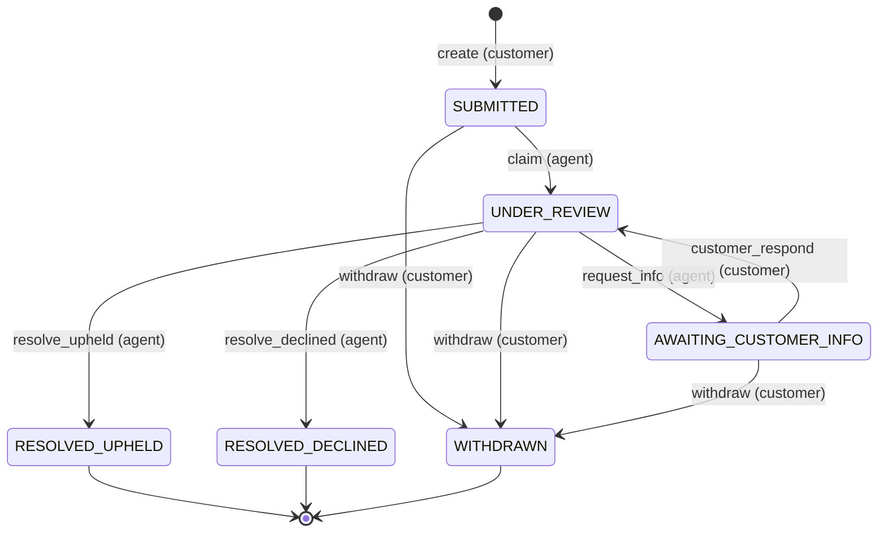
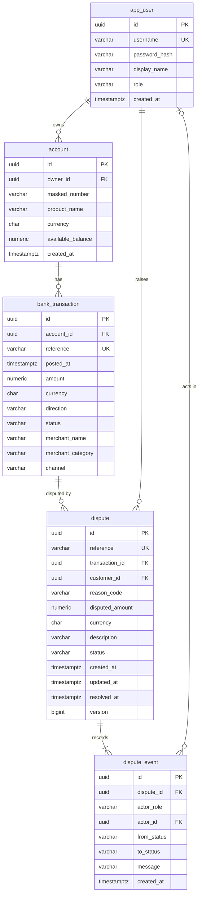

# Dispute Portal: domain model

This is the domain reference for the first release. The API contract is in [`openapi.yaml`](openapi.yaml),
decisions are in [`adr/`](adr/README.md), and the brief-to-test mapping is in [`traceability.md`](traceability.md).

## 1. Roles

| Role | Active in this version | Can do |
|---|---|---|
| `CUSTOMER` | Yes | Sign in, view own accounts and transactions, raise disputes on own transactions, view own dispute history, withdraw own open disputes. |
| `AGENT` | No (model only) | Reserved for the back office: claim, request information, resolve. The role value, the `AGENT` actor and the state machine transitions exist, but no agent users are seeded and no agent endpoints are exposed. |
| `SYSTEM` | Actor only | Not a login role. Reserved as a timeline actor for automated transitions (none in this version). |

Seeded customers: `thandi` (Thandi Mokoena: Everyday cheque account and credit card) and `pieter`
(Pieter van der Merwe: one cheque account). The demo password comes from `APP_DEMO_PASSWORD`
(default `demo-password`, a documented demo value) and is BCrypt-hashed at startup.

## 2. Dispute statuses

| Status | Customer label | Open or closed |
|---|---|---|
| `SUBMITTED` | Submitted | Open |
| `UNDER_REVIEW` | In review | Open |
| `AWAITING_CUSTOMER_INFO` | Action needed | Open |
| `RESOLVED_UPHELD` | Resolved in your favour | Closed |
| `RESOLVED_DECLINED` | Declined | Closed |
| `WITHDRAWN` | Withdrawn | Closed |

Labels live in the frontend i18n bundle. The UI always shows them with an icon plus text, never colour alone.

## 3. State machine

`DisputeStateMachine` is the only code that changes a dispute's status. Each transition checks the
current status and the actor's role, then writes a `dispute_event` row in the same database
transaction as the status change. Any transition not in this table is rejected with
`409 INVALID_DISPUTE_TRANSITION`.

| From | Event | To | Actor | Guard | Exposed in API now |
|---|---|---|---|---|---|
| (none) | `create` | `SUBMITTED` | CUSTOMER (owner) | Transaction is eligible (section 4); request is valid | Yes, `POST /disputes` |
| `SUBMITTED` | `claim` | `UNDER_REVIEW` | AGENT | Dispute is unassigned | No (seeder only) |
| `UNDER_REVIEW` | `request_info` | `AWAITING_CUSTOMER_INFO` | AGENT (assigned) | Message to the customer is required | No (seeder only) |
| `AWAITING_CUSTOMER_INFO` | `customer_respond` | `UNDER_REVIEW` | CUSTOMER (owner) | Response text is required | No (seeder only) |
| `UNDER_REVIEW` | `resolve_upheld` | `RESOLVED_UPHELD` | AGENT (assigned) | Message to the customer is required | No (seeder only) |
| `UNDER_REVIEW` | `resolve_declined` | `RESOLVED_DECLINED` | AGENT (assigned) | Message to the customer is required | No (seeder only) |
| `SUBMITTED`, `UNDER_REVIEW`, `AWAITING_CUSTOMER_INFO` | `withdraw` | `WITHDRAWN` | CUSTOMER (owner) | None | Yes, `POST /disputes/{id}/withdraw` |

Notes:
- Assignment is not stored in this version (no `assigned_agent_id` column), so the "unassigned" and
  "assigned" guards reduce to "actor role is AGENT". The column arrives with the back office.
- `updated_at` changes on every transition. `resolved_at` is set when the dispute enters a closed status.
- The seeder drives demo disputes through these transitions with actor role `AGENT` and a null
  actor id, so the timelines are realistic without any agent users.
- `canWithdraw` in the API is true exactly when the status is open.

In this version the API exposes only `create` and `withdraw`.

## 4. Eligibility

One domain class (`EligibilityPolicy`) decides whether a transaction can be disputed. Rules are
checked in this order, and the first one that fails sets `eligibility.reasonCode`:

| Order | Rule | Reason code when it fails | Customer message |
|---|---|---|---|
| 1 | Direction is `DEBIT` | `NOT_A_DEBIT` | Only money that left your account can be disputed. |
| 2 | Status is `SETTLED` | `PENDING` | This transaction is still pending. You can dispute it once it has cleared. |
| 3 | Posted within the last `APP_DISPUTE_WINDOW_DAYS` days (default 120): `postedAt >= now - window` | `TOO_OLD` | This transaction is older than 120 days and can no longer be disputed. |
| 4 | No existing dispute on the transaction other than `WITHDRAWN` ones | `ALREADY_DISPUTED` | This transaction already has an open dispute. |

When all rules pass: `{eligible: true, reasonCode: null, message: null}`.

Request rules checked on create (on top of eligibility):
- `reasonCode` is one of the eight codes in section 5.
- `amount` is greater than 0, has at most 2 decimals, and is not more than the transaction amount. Partial disputes are allowed.
- `description` is not blank and is 20 to 1000 characters long.

How create reports failures:

| Situation | Response |
|---|---|
| Malformed body or a field rule broken (including amount above the transaction amount) | `400 VALIDATION_FAILED` with `errors[]` |
| Transaction does not exist or belongs to someone else | `404 NOT_FOUND` |
| Rule 4 fails (a non-withdrawn dispute exists) | `409 DISPUTE_ALREADY_EXISTS` |
| Rule 1, 2 or 3 fails | `422 TRANSACTION_NOT_ELIGIBLE` |

Concurrency: `dispute(transaction_id)` cannot be unique because withdrawn disputes may be followed by
a new one, and partial indexes are not portable to H2. Create therefore takes a pessimistic write
lock on the `bank_transaction` row before checking rule 4, so two simultaneous creates for the same
transaction cannot both succeed.

## 5. Reason code catalogue

A Java enum, not a table. The API serves it from `GET /dispute-reasons`, grouped by category in this order.
The categories mirror how card schemes group disputes.

| Category | Category label | Code | Customer wording |
|---|---|---|---|
| `FRAUD` | Fraud | `F01` | I didn't make this transaction |
| `FRAUD` | Fraud | `F02` | My card was lost or stolen |
| `AUTHORISATION` | Authorisation | `A01` | I didn't authorise this debit order |
| `PROCESSING_ERROR` | Processing error | `P01` | I was charged twice |
| `PROCESSING_ERROR` | Processing error | `P02` | The amount is wrong |
| `CONSUMER` | Goods or services | `C01` | I didn't receive the goods or service |
| `CONSUMER` | Goods or services | `C02` | I cancelled, but I'm still being charged |
| `CONSUMER` | Goods or services | `C03` | My refund never arrived |

SLA days per category are not used in this version (ADR 0005).

## 6. Dispute reference

- Format `DSP-<year>-<number>`, for example `DSP-2026-000123`.
- `<number>` is the next value of the database sequence `dispute_reference_seq`, zero-padded to 6 digits.
  The sequence is global and never resets, so references stay unique across years. Past 999999 the
  number simply grows to 7 digits (the column allows 20 characters).
- `<year>` is the calendar year of the creation time, from the application clock.
- The reference is for people (on screen, on the phone). The API identifies disputes by UUID.

## 7. Data model

Flyway migration `V1__init.sql`. The SQL must run unchanged on PostgreSQL 18 and on H2 in
PostgreSQL mode: no partial indexes, no database-specific functions or types, UUIDs generated in Java.
Timestamps are `timestamp with time zone`, written in UTC.

### `app_user`
| Column | Type | Constraints |
|---|---|---|
| `id` | `uuid` | primary key |
| `username` | `varchar(50)` | not null, unique |
| `password_hash` | `varchar(100)` | not null (BCrypt) |
| `display_name` | `varchar(100)` | not null |
| `role` | `varchar(20)` | not null, check in (`CUSTOMER`, `AGENT`) |
| `created_at` | `timestamp with time zone` | not null |

### `account`
| Column | Type | Constraints |
|---|---|---|
| `id` | `uuid` | primary key |
| `owner_id` | `uuid` | not null, FK `app_user(id)` |
| `masked_number` | `varchar(20)` | not null |
| `product_name` | `varchar(100)` | not null |
| `currency` | `char(3)` | not null |
| `available_balance` | `numeric(19,4)` | not null |
| `created_at` | `timestamp with time zone` | not null |

Index `ix_account_owner` on `owner_id` serves "my accounts" and the ownership check on transaction queries.

### `bank_transaction`
| Column | Type | Constraints |
|---|---|---|
| `id` | `uuid` | primary key |
| `account_id` | `uuid` | not null, FK `account(id)` |
| `reference` | `varchar(40)` | not null, unique |
| `posted_at` | `timestamp with time zone` | not null |
| `amount` | `numeric(19,4)` | not null, check (`amount > 0`) |
| `currency` | `char(3)` | not null |
| `direction` | `varchar(6)` | not null, check in (`DEBIT`, `CREDIT`) |
| `status` | `varchar(10)` | not null, check in (`PENDING`, `SETTLED`) |
| `merchant_name` | `varchar(120)` | not null |
| `merchant_category` | `varchar(60)` | not null |
| `channel` | `varchar(20)` | not null, check in (`CARD`, `DEBIT_ORDER`, `EFT`, `ATM`) |

### `dispute`
| Column | Type | Constraints |
|---|---|---|
| `id` | `uuid` | primary key |
| `reference` | `varchar(20)` | not null, unique |
| `transaction_id` | `uuid` | not null, FK `bank_transaction(id)` |
| `customer_id` | `uuid` | not null, FK `app_user(id)` |
| `reason_code` | `varchar(10)` | not null |
| `disputed_amount` | `numeric(19,4)` | not null, check (`disputed_amount > 0`) |
| `currency` | `char(3)` | not null |
| `description` | `varchar(1000)` | not null |
| `status` | `varchar(30)` | not null |
| `created_at` | `timestamp with time zone` | not null |
| `updated_at` | `timestamp with time zone` | not null |
| `resolved_at` | `timestamp with time zone` | null |
| `version` | `bigint` | not null, default 0 (JPA `@Version`; not exposed in the API yet) |

`customer_id` duplicates the owner reachable through `transaction → account → owner` on purpose:
the ownership filter on disputes is a single indexed column.

### `dispute_event`
| Column | Type | Constraints |
|---|---|---|
| `id` | `uuid` | primary key |
| `dispute_id` | `uuid` | not null, FK `dispute(id)` |
| `actor_role` | `varchar(20)` | not null, check in (`CUSTOMER`, `AGENT`, `SYSTEM`) |
| `actor_id` | `uuid` | null, FK `app_user(id)` (null for seeded agent and system events) |
| `from_status` | `varchar(30)` | null (null for the creation event) |
| `to_status` | `varchar(30)` | not null |
| `message` | `varchar(1000)` | null (customer-visible) |
| `created_at` | `timestamp with time zone` | not null |

Append-only: rows are never updated or deleted. The API maps them to `TimelineEvent`
(`to_status` → `status`, `from_status` → `previousStatus`, `actor_role` → `actor`, `created_at` → `occurredAt`).

### Sequence and indexes
- `create sequence dispute_reference_seq start with 1`
- `ix_account_owner` on `account (owner_id)`: "my accounts" and ownership checks.
- `bank_transaction (account_id, posted_at desc)`: the transaction list.
- `dispute (customer_id, created_at desc)`: the dispute history.
- `dispute (transaction_id)`: eligibility rule 4 and `disputeStatus` on transactions.
- `dispute_event (dispute_id, created_at)`: the timeline.

## 8. Money and time

- Money is `BigDecimal` in Java and `numeric(19,4)` in the database; never `float` or `double`.
- The API sends money as a string with exactly two decimals (`"1250.00"`) next to an ISO-4217 `currency`.
  Values are rounded half-even to two decimals on the way out. Requests accept at most two decimals.
- Transaction amounts are always positive; `direction` (`DEBIT`/`CREDIT`) gives the sign. The UI
  shows debits as "-R 1 250,00" (en-ZA formatting) with a text cue, not colour alone.
- All demo data is ZAR. A dispute's currency is always its transaction's currency; there is no FX.
- Timestamps are stored in UTC (`timestamp with time zone`) and sent as ISO-8601 with offset.
- Date filters (`from`, `to`) are calendar dates, inclusive, interpreted in Africa/Johannesburg.
- Code reads time from an injected `Clock`, so eligibility and seeding are testable and seeded dates
  stay relative to today.

## 9. Ownership

- A customer can only read or act on their own accounts, transactions and disputes.
- Ownership is enforced in the repository query (`... and owner/customer = :currentCustomer`), not by
  loading first and checking afterwards.
- Someone else's resource returns `404 NOT_FOUND`, exactly like a missing one, never `403`. This stops
  customers from discovering which IDs exist.
- `403 FORBIDDEN` is reserved for a missing or invalid CSRF token, or a role that may not call an
  operation.
- `OwnershipAcceptanceTest` proves this for every customer endpoint with two seeded customers.

## 10. Error codes

Every 4xx/5xx is an RFC 9457 problem (`application/problem+json`) with a stable `code`. Clients
branch on `code`, never on `title` or `detail`.

| Code | HTTP | When |
|---|---|---|
| `VALIDATION_FAILED` | 400 | Bean Validation failure (with `errors[]`), malformed JSON, or a parameter type mismatch (for example a path id that is not a UUID) |
| `BAD_CREDENTIALS` | 401 | Wrong username or password on login |
| `UNAUTHENTICATED` | 401 | No valid session |
| `FORBIDDEN` | 403 | Missing or invalid CSRF token, or a role that may not call the operation |
| `NOT_FOUND` | 404 | Resource does not exist or belongs to another customer |
| `METHOD_NOT_ALLOWED` | 405 | HTTP method not supported on the path |
| `NOT_ACCEPTABLE` | 406 | `Accept` header asks for a media type the API cannot produce |
| `DISPUTE_ALREADY_EXISTS` | 409 | Transaction already has a non-withdrawn dispute |
| `INVALID_DISPUTE_TRANSITION` | 409 | State machine rejects the transition (for example withdrawing a closed dispute) |
| `UNSUPPORTED_MEDIA_TYPE` | 415 | Request body is not `application/json` |
| `TRANSACTION_NOT_ELIGIBLE` | 422 | Transaction is a credit, pending, or older than the dispute window |
| `TOO_MANY_LOGIN_ATTEMPTS` | 429 | Five failed logins for the username within 15 minutes |
| `CLIENT_ERROR` | other 4xx | Any other client error the framework raises |
| `INTERNAL_ERROR` | 500 | Unexpected failure; no stack traces, SQL or class names exposed |

The framework-level codes (`METHOD_NOT_ALLOWED`, `NOT_ACCEPTABLE`, `UNSUPPORTED_MEDIA_TYPE`,
`CLIENT_ERROR`) can occur on any operation, so `openapi.yaml` lists them once in the `ProblemCode`
enum rather than on every operation.

## 11. Assumptions

1. The session cookie is Spring's default `JSESSIONID`; the CSRF cookie is `XSRF-TOKEN`, readable by
   JavaScript, and rotated on login and logout.
2. `POST /auth/logout` is idempotent and returns 204 without a session; it still needs the CSRF header.
3. Login: username 1-50 characters, password 1-72 characters (the BCrypt input limit). After five
   failures for a username within 15 minutes, every attempt for it gets 429 until the window passes.
4. `disputed=true` keeps only transactions with a non-withdrawn dispute; `false` or absent means no filter.
5. `page` below 0, `size` outside 1..100, `from` after `to`, or a path id that is not a UUID return
   `400 VALIDATION_FAILED`.
6. `q` is a case-insensitive "contains" match, 1-100 characters.
7. Accounts are listed by product name; transactions by `posted_at` desc then `id`; disputes by
   `created_at` desc then `id`, so paging is stable.
8. The timeline is oldest first and contains only customer-visible information. The creation and
   withdrawal events carry no message.
9. ProblemDetail `type` is `about:blank`; clients branch on `code`.
